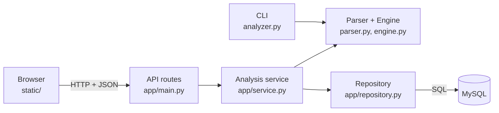

# Log Threat Analyzer

Upload a web server log, detect **brute force** and **scanning** attacks, and come back to the results later.

The project started as a Python command-line tool and grew into a small web application:
a browser page, a FastAPI backend that reuses the original detection engine, and a MySQL database
that keeps the history of every analysis.

> "I want to upload a log file through the browser, get alerts about suspicious activity,
> and come back to the results tomorrow." — the user story this version was built for.

---

## What it detects

| Threat | Log lines | Rule (defaults, configurable) |
|---|---|---|
| **Brute Force** | `401` (failed login) | 5 or more from the same IP within 60 seconds |
| **Scanning** | `403` / `404` (forbidden / not found) | 15 or more from the same IP within 60 seconds |

Detection details:
- **One alert per attack:** after an alert, the same IP and threat type is not reported again until a full window has passed.
- **Any line order:** lines do not have to be in time order (servers write a request when it *finishes*; merged or rotated logs jump in time). Only events that are really within one window are counted together.
- **Time zones:** every time is converted to **UTC** and shown in the user's local time in the browser.
- **"No threats" is not "not a log":** a file with no recognizable log lines is reported as an error, not as "0 alerts".

## Features

**Web app**
- Upload a log file (up to 10 MB) and see its alerts
- History of the last 2 days, and search by date
- The same content with the same settings is recognized (SHA-256 fingerprint) and not analyzed twice
- Failed analyses are recorded with their reason; partial results are never shown as complete

**Command line** (no database needed)
- Streams the file line by line (low memory) and writes alerts to a JSON Lines file

## Architecture



A modular monolith with one responsibility per layer: the engine knows nothing about HTTP or the
database (so the CLI and the web app share it), and **all SQL lives in the repository**.
The full design — data model, API contract, request flow and the reasoning behind every decision —
is in **[docs/DESIGN.md](docs/DESIGN.md)**.

## Tech stack

Python 3.12 · FastAPI · MySQL 8 · plain HTML/CSS/JavaScript · pytest · Ubuntu

## Project structure

```
├── parser.py, engine.py     # log parsing and threat detection (shared by CLI and web app)
├── analyzer.py              # command-line interface
├── generator.py             # creates a sample log file for experiments
├── app/
│   ├── main.py              # API routes
│   ├── service.py           # analysis flow: fingerprint, reuse, analyze, store
│   ├── repository.py        # all SQL
│   ├── schemas.py           # JSON response shapes
│   └── config.py            # database settings from .env
├── static/                  # the web page (index.html, app.js, style.css)
├── schema.sql               # database tables
├── scripts/setup_db.sh      # one-time local database setup
├── tests/                   # unit, integration, database and API tests
└── docs/DESIGN.md           # design document
```

## Getting started

Developed and tested on **Ubuntu 24.04** with **Python 3.12**.

```bash
git clone https://github.com/naamaovd-code/log-threat-analyzer.git
cd log-threat-analyzer
python3 -m venv venv
source venv/bin/activate
pip install -r requirements.txt
```

### Web app

One-time database setup — installs MySQL (low-memory settings), creates the app database and a separate
test database, and writes the connection settings with a random password to `.env` (never committed):

```bash
bash scripts/setup_db.sh
```

Start the server:

```bash
uvicorn app.main:app --reload --port 8000
```

- http://localhost:8000 — the web page
- http://localhost:8000/docs — interactive API documentation

### Command line

```bash
python3 analyzer.py path/to/access.log -w 60 -b 5 -s 15 -o output/alerts.jsonl
```

| Option | Meaning | Default |
|---|---|---|
| `-w`, `--window` | time window in seconds | 60 |
| `-b`, `--brute-force-threshold` | failed logins that trigger an alert | 5 |
| `-s`, `--scanning-threshold` | 403/404 requests that trigger an alert | 15 |
| `-o`, `--output` | output file (JSON Lines) | `output/alerts.jsonl` |

Sample logs:
- `tests/fixtures/sample_logs.txt` — small, with one brute force and one scanning attack
- `mkdir -p logs && python3 generator.py` — 10,000 lines of random traffic in `logs/server_logs.txt` (usually without attacks)

## Supported log format

Common Log Format, as written by Apache and Nginx:

```
201.87.61.169 - - [23/Aug/2026:18:36:31 +0000] "POST /login HTTP/1.1" 401 512
```

Lines in other formats (error messages, `sshd` lines, …) are skipped.

## API

| Method | Path | Description |
|---|---|---|
| `POST` | `/api/analyses` | Upload and analyze a file. `201` new, `200` already analyzed (`reused: true`) |
| `GET` | `/api/analyses?from=&to=` | History by analysis date, newest first. Default: last 2 days |
| `GET` | `/api/analyses/{id}` | One analysis |
| `GET` | `/api/analyses/{id}/alerts` | Its alerts, optionally `?threat_type=Scanning` |
| `GET` | `/api/health` | Server is up |

Errors are always JSON: `{"detail": "..."}` — `400` empty or not a log file, `404` not found,
`413` file too large, `422` invalid input, `500` unexpected failure.

## Tests

```bash
python3 -m pytest
```

120 tests: parser, engine (thresholds, windows, cooldown, out-of-order lines, time zones), CLI,
the analysis service, the repository against a real MySQL **test** database, the API, and the web page
(including XSS and path-traversal checks).
Database tests are **skipped**, not failed, when MySQL is not set up.

## Limitations and next steps

- Analysis runs inside the request, so files are limited to 10 MB. Larger files would need a background job.
- One log format (Common Log Format).
- No user accounts: everyone who can reach the server sees all analyses. Meant to run locally.
- About 70% of the analysis time is spent parsing timestamps — the first place to optimize.
