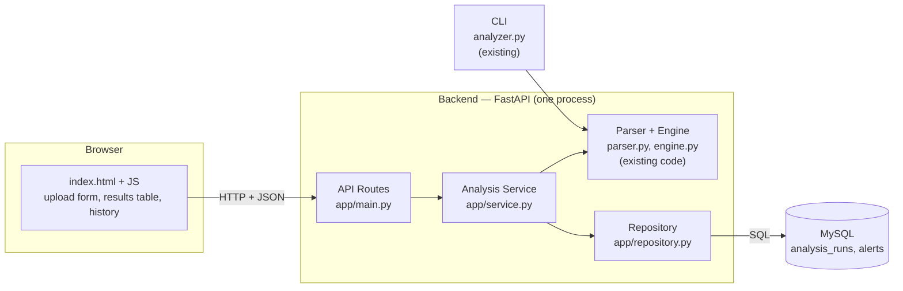
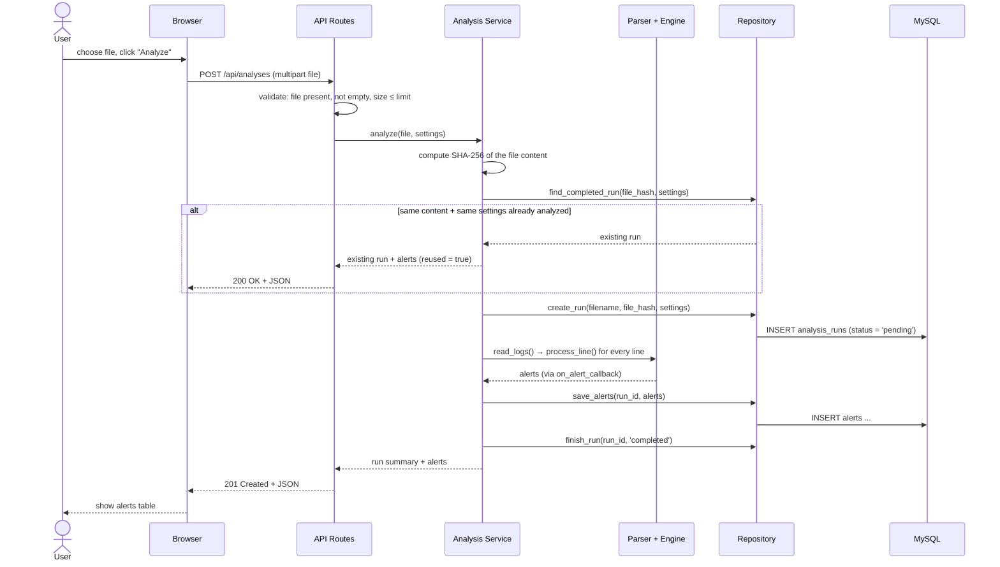
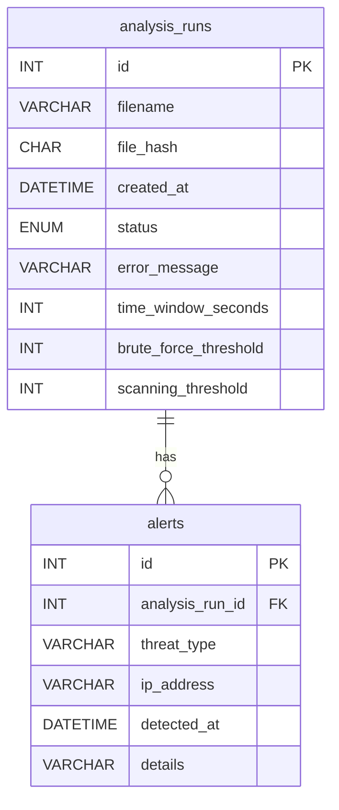

# Log Threat Analyzer — Web App Design

Status: **Draft for design review**
Branch: `web-app`

---

## 1. Goal

### User story
> "I want to upload a log file through the browser, get alerts about suspicious activity, and come back to the results tomorrow."

### What the MVP includes
| # | Capability | Done when |
|---|---|---|
| 1 | **Upload** a log file from the browser | A file chosen in the browser reaches the server |
| 2 | **Analyze** it with the existing parser + engine | The alerts are identical to what the CLI produces for the same file |
| 3 | **History**: store and retrieve results | After restarting the server, yesterday's runs and alerts are still visible |

### Out of scope (for now)
- User accounts / login
- Storing the raw log lines
- Background processing of very large files (see §7, decision D3)
- Deleting runs
- Deployment to a public server

### Constraints
- The existing CLI (`analyzer.py`) must keep working unchanged.
- `parser.py` and `engine.py` are reused as-is, not rewritten.

---

## 2. Architecture

A **modular monolith**: one backend application with clearly separated internal layers.



### Responsibilities

| Layer | File | Responsible for | Must NOT |
|---|---|---|---|
| Client | `static/index.html` | Choose a file, send requests, display results | Talk to the database directly |
| API Routes | `app/main.py` | HTTP: receive requests, validate input, choose status codes, return JSON | Contain detection logic or SQL |
| Analysis Service | `app/service.py` | Orchestrate one analysis: create run → run parser+engine → save alerts → mark completed/failed | Know about HTTP |
| Parser + Engine | `parser.py`, `engine.py` | Read lines, detect threats | Know that a database or HTTP exists |
| Repository | `app/repository.py` | **All** SQL lives here | Contain business logic |
| Database | MySQL | Persist runs and alerts | — |

### Dependency rule
Dependencies point in one direction only: `API → Service → (Engine, Repository)`.
The engine never imports anything from `app/`. This is why the CLI and the web app can share the same engine.

---

## 3. Request lifecycle — "Analyze file"



### Failure path
If anything fails after the run was created (unreadable file, DB error):
1. The service marks the run as `failed` and stores a short `error_message`.
2. Alerts that were already saved for that run are **deleted** — a partial result must never look like a complete one.
3. The API returns an error status (see §5) and the run still appears in the history as `failed`.

---

## 4. Data model

### Entity relationship
One analysis run has many alerts (**one-to-many**).



### Table `analysis_runs`
| Column | Type | Notes |
|---|---|---|
| `id` | `INT AUTO_INCREMENT` **PK** | The identifier used in URLs (`/api/analyses/42`) |
| `filename` | `VARCHAR(255) NOT NULL` | The original name, for display only. **Not unique** — two different files can have the same name |
| `file_hash` | `CHAR(64) NOT NULL` | SHA-256 of the file content (64 hex characters). Identifies the *content*, not the name |
| `created_at` | `DATETIME NOT NULL DEFAULT CURRENT_TIMESTAMP` | Stored in UTC |
| `status` | `ENUM('pending','completed','failed') NOT NULL DEFAULT 'pending'` | |
| `error_message` | `VARCHAR(500) NULL` | Only for `failed` runs |
| `time_window_seconds` | `INT NOT NULL` | The settings used, so a result can be explained and reproduced later |
| `brute_force_threshold` | `INT NOT NULL` | |
| `scanning_threshold` | `INT NOT NULL` | |

### Table `alerts`
| Column | Type | Notes |
|---|---|---|
| `id` | `INT AUTO_INCREMENT` **PK** | |
| `analysis_run_id` | `INT NOT NULL` **FK** → `analysis_runs.id` `ON DELETE CASCADE` | Deleting a run deletes its alerts |
| `threat_type` | `VARCHAR(50) NOT NULL` | `'Brute Force'` / `'Scanning'` |
| `ip_address` | `VARCHAR(45) NOT NULL` | 45 characters is enough for IPv6 as well |
| `detected_at` | `DATETIME NOT NULL` | Time of the event that triggered the alert (from the log, UTC) |
| `details` | `VARCHAR(255) NOT NULL` | Human-readable description from the engine |

Indexes:
- `alerts (analysis_run_id, threat_type)` — every alert query filters by run, often also by type.
- `analysis_runs (file_hash)` — the duplicate check looks runs up by hash on every upload.

### Mapping engine output → table
| Engine alert key | Column |
|---|---|
| `type` | `threat_type` |
| `ip_address` | `ip_address` |
| `timestamp` (`"2026-11-10 10:00:05"`) | `detected_at` |
| `details` | `details` |

### DDL (draft for `schema.sql`)
```sql
CREATE TABLE analysis_runs (
    id                    INT AUTO_INCREMENT PRIMARY KEY,
    filename              VARCHAR(255) NOT NULL,
    file_hash             CHAR(64)     NOT NULL,
    created_at            DATETIME     NOT NULL DEFAULT CURRENT_TIMESTAMP,
    status                ENUM('pending', 'completed', 'failed') NOT NULL DEFAULT 'pending',
    error_message         VARCHAR(500) NULL,
    time_window_seconds   INT NOT NULL,
    brute_force_threshold INT NOT NULL,
    scanning_threshold    INT NOT NULL,
    INDEX idx_runs_file_hash (file_hash)
);

CREATE TABLE alerts (
    id               INT AUTO_INCREMENT PRIMARY KEY,
    analysis_run_id  INT          NOT NULL,
    threat_type      VARCHAR(50)  NOT NULL,
    ip_address       VARCHAR(45)  NOT NULL,
    detected_at      DATETIME     NOT NULL,
    details          VARCHAR(255) NOT NULL,
    CONSTRAINT fk_alerts_run
        FOREIGN KEY (analysis_run_id) REFERENCES analysis_runs(id)
        ON DELETE CASCADE,
    INDEX idx_alerts_run_type (analysis_run_id, threat_type)
);
```

### Example queries
```sql
-- All alerts of run 42, in time order
SELECT threat_type, ip_address, detected_at, details
FROM alerts
WHERE analysis_run_id = 42
ORDER BY detected_at;

-- History list: every run with its number of alerts (newest first)
SELECT r.id, r.filename, r.created_at, r.status, COUNT(a.id) AS alert_count
FROM analysis_runs r
LEFT JOIN alerts a ON a.analysis_run_id = r.id
GROUP BY r.id
ORDER BY r.created_at DESC;

-- Duplicate check: was this exact content already analyzed with these settings?
SELECT id
FROM analysis_runs
WHERE file_hash = '3f8a...e91b'
  AND time_window_seconds = 60
  AND brute_force_threshold = 5
  AND scanning_threshold = 15
  AND status = 'completed'
ORDER BY created_at DESC
LIMIT 1;

-- How many alerts of each type in run 42
SELECT threat_type, COUNT(*) AS total
FROM alerts
WHERE analysis_run_id = 42
GROUP BY threat_type;
```

---

## 5. API contract

Base path: `/api`. All responses are JSON. Errors always look like `{"detail": "<message>"}`.

### `GET /api/health`
Checks the server is up.
- `200` → `{"status": "ok"}`

### `POST /api/analyses`
Upload a log file and analyze it.

**Request** — `multipart/form-data`
| Field | Type | Required | Default |
|---|---|---|---|
| `file` | file | yes | — |
| `time_window_seconds` | int, 1–3600 | no | 60 |
| `brute_force_threshold` | int, ≥ 1 | no | 5 |
| `scanning_threshold` | int, ≥ 1 | no | 15 |

**Response `201 Created`** — a new analysis was run.
**Response `200 OK`** — the same content was already analyzed with the same settings; the existing run is returned with `"reused": true` (see D11).
```json
{
  "id": 42,
  "filename": "server_logs.txt",
  "created_at": "2026-11-10T14:00:00",
  "status": "completed",
  "reused": false,
  "settings": {"time_window_seconds": 60, "brute_force_threshold": 5, "scanning_threshold": 15},
  "alert_count": 2,
  "alerts": [
    {"threat_type": "Brute Force", "ip_address": "10.0.0.1", "detected_at": "2026-11-10T10:00:05", "details": "5 failed attempts in 60 seconds"}
  ]
}
```

**Errors**
| Status | When |
|---|---|
| `400 Bad Request` | No file, or the file is empty |
| `413 Payload Too Large` | File larger than the limit (MVP: 10 MB) |
| `422 Unprocessable Entity` | Invalid settings (e.g. negative threshold) — FastAPI validates this automatically |
| `500 Internal Server Error` | Analysis or database failed. The run is saved as `failed` |

### `GET /api/analyses`
History, newest first.
- `200` →
```json
[
  {"id": 42, "filename": "server_logs.txt", "created_at": "2026-11-10T14:00:00", "status": "completed", "alert_count": 2}
]
```

### `GET /api/analyses/{id}`
One run (same shape as the `POST` response, without `alerts`).
- `200` → run object
- `404` → `{"detail": "Analysis 42 not found"}`

### `GET /api/analyses/{id}/alerts`
Alerts of one run. Optional filter: `?threat_type=Scanning`.
- `200` → list of alerts (same shape as in the `POST` response)
- `404` → run does not exist

---

## 6. Project structure (target)

```
log_threat_analyzer/
├── parser.py, engine.py          # existing core — unchanged
├── analyzer.py                   # existing CLI — unchanged
├── generator.py
├── app/
│   ├── __init__.py
│   ├── main.py                   # API routes
│   ├── service.py                # analysis orchestration
│   ├── repository.py             # all SQL
│   └── config.py                 # reads DB settings from environment / .env
├── static/
│   └── index.html                # upload page
├── schema.sql
├── docs/DESIGN.md                # this document
├── tests/
│   ├── fixtures/sample_logs.txt
│   ├── test_parser.py, test_engine.py, test_cli.py, test_integration.py
│   ├── test_service.py           # service with a fake repository
│   ├── test_repository.py        # against a real test database
│   └── test_api.py               # FastAPI TestClient
├── requirements.txt
└── .env                          # DB password — never committed (.gitignore)
```

---

## 7. Decisions and trade-offs

| # | Decision | Why | Revisit when |
|---|---|---|---|
| D1 | **Modular monolith** (one FastAPI app), not microservices | One developer, one deployable; layers still keep code separated | Parts need to scale independently |
| D2 | **Raw SQL** with `mysql-connector-python`, no ORM | Learning goal is SQL; only two tables | Many tables / complex relations |
| D3 | **Synchronous** analysis inside the request, with a **10 MB** file limit | Simplest correct solution; the engine processes ~10k lines in well under a second | Files are large enough that the browser waits noticeably → move to a background job that returns a run id with `status = pending` |
| D4 | **Do not store raw log lines** | Less storage, less sensitive data stored | Users need to search raw events |
| D5 | Uploaded file saved to a **temporary file**, deleted after analysis | `read_logs` reads from a path; no permanent copies | — |
| D6 | **Store the settings used** in each run | Same file + different thresholds = different results; history must be explainable | — |
| D7 | DB credentials in **`.env`**, not in code | Secrets must not reach GitHub | — |
| D8 | Frontend is **plain HTML + JS** served by FastAPI | No build tools; focus is on backend and DB | UI becomes complex |
| D9 | **Alert cooldown**: after an alert, the same IP + threat type is not alerted again until one full time window has passed. Threshold is **inclusive** (5 attempts = alert) | One attack should produce one alert, not duplicates. A long attack still produces one alert per window, which shows it is ongoing | Users need a separate "attack ended" event |
| D10 | **All alert times are stored in UTC** (converted from the offset in the log line) | Logs from servers in different time zones become comparable. The browser converts to local time for display | — |
| D11 | **Duplicate uploads are detected by SHA-256 of the content + the settings**, and the existing completed run is returned (`reused: true`) | The filename does not identify the content. The same content with different thresholds gives different results, so settings are part of the key | Users want to force a re-run |

---

## 8. Design review — resolved questions

| Question | Decision |
|---|---|
| Should 10 failed logins in one minute produce 2 alerts? | No — one alert per IP + type per window (D9). Implemented in `engine.py` with tests |
| Time zones | Convert to UTC (D10). Implemented in `engine.py` with tests |
| Same file uploaded twice | Detect by content hash + settings, reuse the result (D11) |
| Deleting runs | Out of scope for the MVP |

---

## 9. Implementation phases

| Phase | Deliverable | Done when |
|---|---|---|
| 0 ✅ | Stable base: tests, fixtures, parser fixes | 27 tests pass on a clean clone |
| 1 | This document | Reviewed; open questions answered |
| 2 | FastAPI skeleton + `/api/health` + test | `localhost:8000/docs` opens on Windows |
| 3 | `POST /api/analyses` without DB | Same alerts as the CLI for the fixture |
| 4 | MySQL + `schema.sql` + repository + tests | Save a run, read it back, identical |
| 5 | API wired to the DB + `GET` endpoints + failure handling | Results survive a server restart |
| 6 | Upload page | Full user story works from the browser |
| 7 | README, merge to `main` | — |
